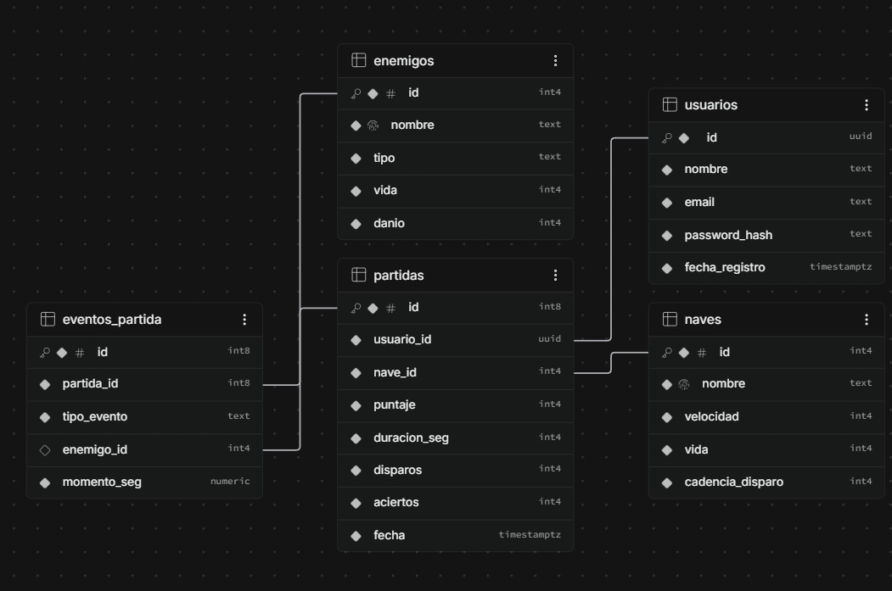

# Space Shooter Ranking

## 1) Descripción

**Space Shooter Ranking** es un videojuego web 2D en el que una nave debe moverse, disparar a enemigos y esquivar meteoritos. El juego cuenta con registro e inicio de sesión mediante JWT, un ranking global con las mejores puntuaciones, persistencia de datos en Supabase (PostgreSQL) y un dashboard visual en Looker Studio.

**Objetivo:** Desarrollar el proyecto en equipo durante 3 días, siguiendo una metodología estructurada por fases y utilizando agentes/skills de OpenCode para automatizar tareas.

## 2) Stack tecnológico

| Componente | Tecnologías | Propósito |
|---|---|---|
| **Frontend** | HTML, CSS, JavaScript, Vite, Phaser 3 | Interfaz web y motor del juego 2D |
| **Backend** | Node.js, Express, jsonwebtoken, bcrypt, @supabase/supabase-js | API REST para autenticación, puntuaciones y ranking |
| **Base de datos** | Supabase (PostgreSQL) | Persistencia de usuarios, partidas y puntuaciones |
| **Dashboard** | Looker Studio | Visualización del ranking global y estadísticas |
| **DevOps/IA** | OpenCode (agentes + skills) | Automatización, organización y desarrollo asistido |

## 3) Agentes y Skills

El proyecto utiliza **agentes personalizados de OpenCode** en formato oficial: archivos `.md` con frontmatter ubicados en `.opencode/agents/`.

### Agentes disponibles

| Agente | Propósito | Alcance | Cuándo usarlo |
|---|---|---|---|
| **`architect`** | Arquitecto de software senior. Diseña estructura, modelo de datos y revisa decisiones técnicas. | `/docs/`, `database/schema.sql`, `database/views.sql`, `README.md`, `AGENTS.md`, `opencode.json` | Antes de implementar funcionalidades. Para diseñar ER, contratos API, arquitectura. **NO escribe código de producción.** |
| **`game-dev`** | Desarrollador frontend especializado en Phaser 3, Vite, HTML, CSS, JS. | **ÚNICAMENTE** `/game/` | Para desarrollar escenas, entidades, páginas, estilos y lógica del juego. Integración con API backend. |
| **`backend-dev`** | Desarrollador backend especializado en Node.js, Express, JWT, bcrypt, Supabase. | **ÚNICAMENTE** `/backend/` y `/database/` | Para crear API REST, endpoints auth/ranking, middlewares, configuración Supabase y scripts SQL (`schema.sql`, `seed.sql`, `views.sql`). |
| **`qa-tester`** | QA Tester que revisa código, escribe pruebas y reporta bugs. | Lectura completa. Escritura solo en `/docs/` y archivos de test. **NO modifica código de producción.** | Para revisiones de calidad, detección de bugs, validación de convenciones, reportes antes de merge a `develop`. | 

### Skills

**TODO:** Definir skills específicos en `.opencode/skills/<nombre>/SKILL.md` según necesidades del proyecto. Cada skill debe incluir frontmatter con `name` y `description`.

### Notas

- Los agentes siguen el formato oficial de OpenCode v2 (archivos `.md` con frontmatter YAML).
- Cada agente tiene permisos y límites de carpetas claramente definidos.
- Todos los agentes respetan las reglas de `AGENTS.md` (Windows, español, sin claves reales).

## 4) Instalación

**TODO:** Incluir instrucciones detalladas para instalar y ejecutar el proyecto localmente.

Pasos previstos:
1. Clonar el repositorio
2. Configurar variables de entorno (`.env`) basadas en `.env.example`
3. Instalar dependencias (frontend y backend) - *No aplica en FASE 1*
4. Ejecutar migraciones de base de datos (`database/schema.sql`)
5. Iniciar backend (Express)
6. Iniciar frontend (Vite)
7. Acceder al juego en `http://localhost:5173`

**Nota:** En FASE 1 no se instalan dependencias. Solo se crea la estructura.

## 5) Modelo ER / Diccionario de datos

El modelo entidad-relación completo, con el diagrama y el diccionario de datos,
está en este documento.



Entidades: `usuarios`, `naves`, `enemigos`, `partidas` y `eventos_partida`.

Los scripts SQL están en `/database/schema.sql`, `/database/seed.sql` y `/database/views.sql`.

## 6) Enlace al dashboard

**TODO:** Agregar el enlace público al dashboard de Looker Studio una vez creado.

**Formato sugerido:**
```
[Dashboard de Space Shooter Ranking](URL_PENDIENTE)
```

**Notas:**
- El dashboard debe mostrar el ranking global de mejores puntuaciones.
- Se recomienda conectar directamente a las vistas creadas en Supabase (`views.sql`).
- Actualizar este enlace cuando esté disponible.

## Estado del Proyecto

- **FASE 1:** Estructura del repositorio - ✅ Completada
- **FASES 2-6:** Por definir - ⏳ Pendientes

**Última actualización:** Octubre 2026
